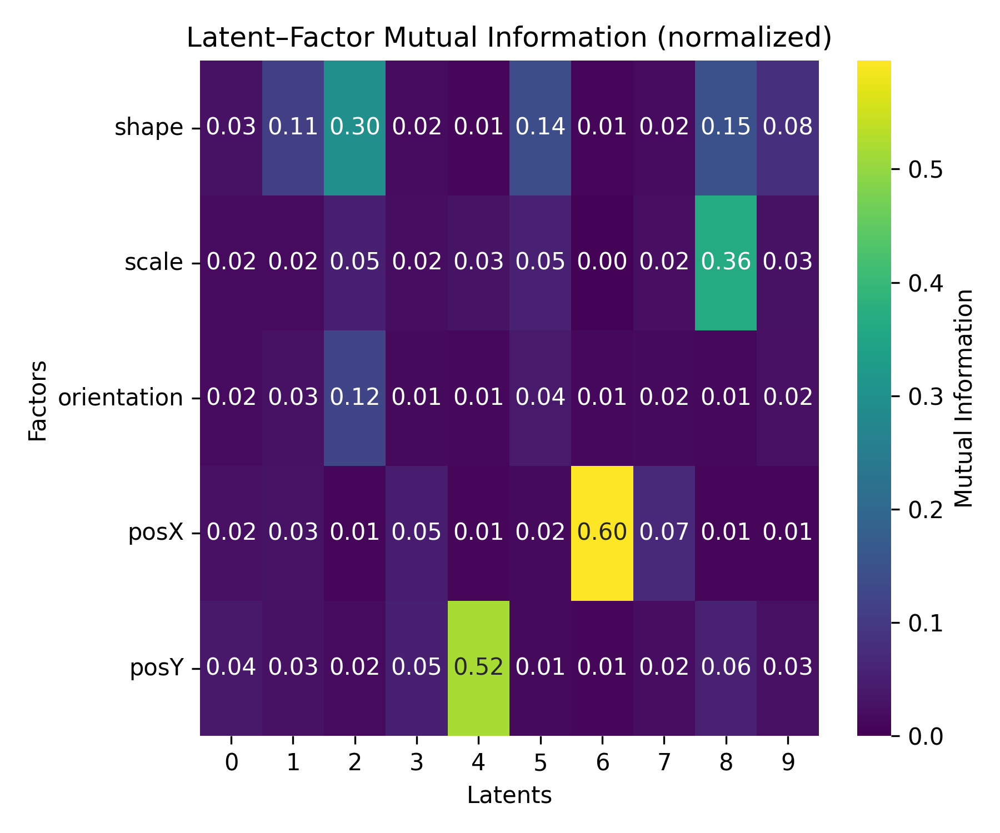

# Disentangled Representations

**Representations** determines how data looks like to a machine learning algorithm. Some car detection algorithm might have "number of wheels" or "the number of corners" within their representation. Representations used to be handcrafted until we created a method to learn them. **Representation learning** is the method of learning representations. **Disentanglement** is important when determining how good the representation is.

In this experiment, we attempt to learn disentangled representations. The DSprites dataset is a set of images derived from a set of underlying factors, \['shape', 'scale', 'orientation', 'posX', 'posY'\]. We try to train a neural network whose neurons corresponds to each of these factors.

Here is a heatmap of factors to neurons (latents).

The "scale" factor activates the 8th neuron, the "posX" factor activates the 6th neuron, and the "posY" factor activates the 4th neuron.

We can see what happens when we change the values of a certain neuron. Here is the "xPos" factor.

and here is the "yPos" factor.

## Replication

We trained 15 models across different betas and seeds. Use and modify `sweep.py` to train with your own hyperparameters.

## References

1. Higgins, I., et al. (2017). [β-VAE: Learning Basic Visual Concepts with a Constrained Variational Framework](https://openreview.net/forum?id=Sy2fzU9gl). *ICLR*.
2. Burgess, C. P., et al. (2018). [Understanding Disentangling in β-VAE](https://arxiv.org/abs/1804.03599). *arXiv:1804.03599*.
